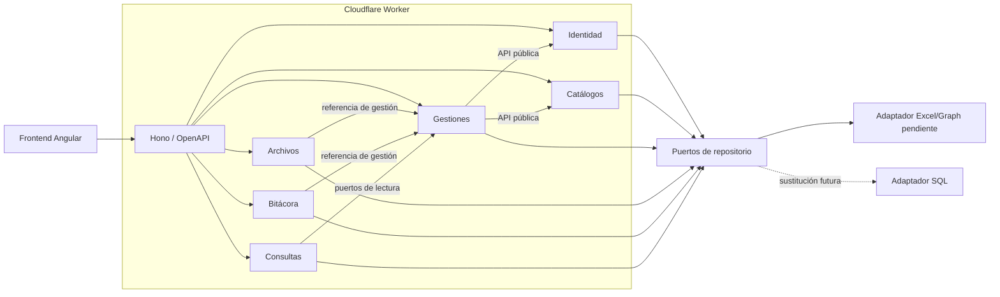
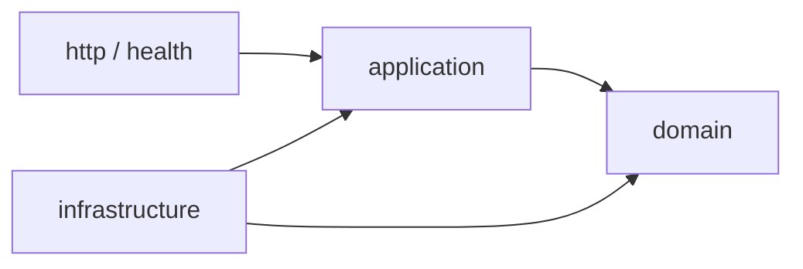

# Arquitectura

## Monolito modular

Las flechas representan dependencias a APIs públicas, no imports hacia carpetas
internas.

## Regla de capas

- `domain` no conoce Hono, Cloudflare, Graph, Excel ni SQL.
- `application` declara casos de uso y puertos.
- `infrastructure` implementa puertos.
- `http` valida, traduce y serializa; no consulta fuentes de datos directamente.

## Aislamiento automático

- ESLint restringe imports profundos mediante aliases de módulos.
- dependency-cruiser rechaza ciclos y dependencias de capas inválidas.
- CI ejecuta ambas verificaciones antes de desplegar.
- Cada módulo expone un único `index.ts` como API pública.

## Extracción a otro Worker

Al separar un módulo se conserva su contrato de aplicación y se reemplaza el
adaptador en proceso por uno basado en Cloudflare Service Bindings. Para eventos
asíncronos se puede sustituir el publicador interno por Queues. El módulo
consumidor no debe conocer RPC, HTTP ni bindings concretos.

## Decisiones pendientes

- Responsabilidad de `Etapa_gestion`.
- Estrategia OAuth/almacenamiento para Excel.
- Algoritmo y parámetros de hash de contraseñas.
- Reglas definitivas de estados, códigos, fechas y semáforos.
