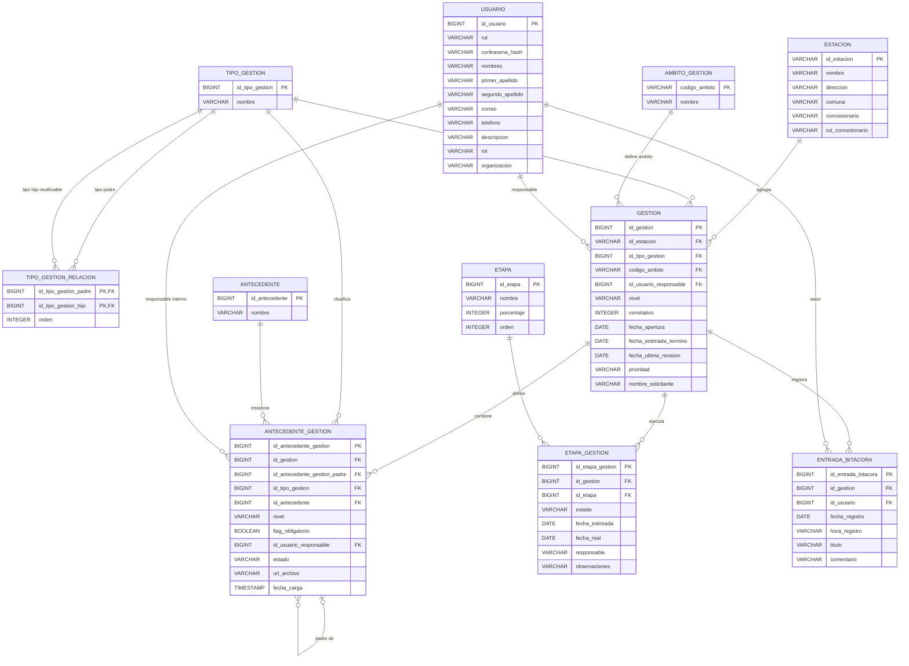

# ERD provisional transcrito desde el PNG

> Estado: **pendiente de confirmación**. Los nombres de entidades, campos y
> relaciones provienen de `Esquemas Base de Datos (1).png`. La imagen no declara
> tipos, nulabilidad ni longitudes; los tipos indicados abajo son inferencias
> orientativas para poder expresar el modelo y no constituyen todavía un contrato
> de persistencia.

## Ambigüedades e inconsistencias por confirmar

1. **Resuelto:** el campo mostrado como `id_subgestion_padre` representa la
   instancia padre dentro de la misma tabla `Antecedente_gestion`, no una gestión
   o subtrámite padre. Para evitar esa confusión se transcribe como
   `id_antecedente_gestion_padre`. `Antecedente` sigue siendo el catálogo o
   biblioteca y `Antecedente_gestion` representa cada aparición concreta dentro
   de una gestión.
2. **Resuelto:** `Antecedente_gestion.id_tipo_gestion` no repite
   `Gestion.id_tipo_gestion`. La gestión principal tiene su propio tipo y cada
   `Antecedente_gestion`, al representar un elemento de nivel inferior, puede
   tener otro tipo de gestión. Se conservan ambas FK y no se debe derivar una de
   la otra. También se confirmó que `id_antecedente` es obligatorio: no puede
   existir un registro de `Antecedente_gestion` sin un antecedente del catálogo
   asociado.
3. **Resuelto:** el “trámite/gestión específica” de segundo nivel
   del frontend corresponde también a un registro de `Tipo_gestion`; no se
   creará un catálogo separado. Como un tipo inferior puede reutilizarse bajo
   varios tipos superiores, la extensión `Tipo_gestion_relacion` modela una
   asociación muchos-a-muchos autorreferente con orden. Esta tabla no aparece en
   el PNG original; se agrega como extensión confirmada al cruzarlo con el
   frontend. La aplicación deberá rechazar autorrelaciones directas y ciclos.
4. `Gestion` no contiene en la imagen `estado`, código visible completo,
   modalidad de creación ni la gestión específica seleccionada; todos aparecen
   en los flujos del frontend.
5. **Resuelto parcialmente:** responsables de `Gestion` y
   `Antecedente_gestion` son usuarios internos registrados y deben modelarse con
   una FK `id_usuario_responsable` obligatoria. La responsabilidad de
   `Etapa_gestion` queda pendiente; se conserva provisionalmente como texto sin
   dar esa interpretación por válida.
6. **Resuelto:** se mantendrá autenticación local mediante RUT y contraseña.
   `Usuario.contrasena_hash` permanece en el modelo. El algoritmo, parámetros de
   costo, renovación y recuperación de credenciales deberán definirse en un ADR
   de seguridad antes de implementar autenticación real; el esqueleto solo
   expondrá contratos sin validar credenciales.
7. `Entrada_bitacora` separa fecha y hora; convendría confirmar si debe ser un
   único timestamp con zona horaria. El frontend además maneja tipo de entrada,
   autor mostrado, iniciales y marca de entrada automática.
8. `url_archivo` no aclara si el archivo vive en OneDrive/SharePoint, R2 u otro
   repositorio. Para no acoplar el dominio, probablemente convenga guardar una
   referencia opaca más metadatos, no asumir una URL permanente.
9. No están indicadas nulabilidad, longitudes, unicidad, reglas de borrado ni
   dominios válidos para estados, prioridad y nivel.
10. Las cardinalidades se interpretaron visualmente como uno-a-muchos; deben
    confirmarse especialmente las colecciones de antecedentes y etapas, que
    podrían ser opcionales al crear un borrador.

## Cobertura preliminar frente al frontend

El PNG cubre el núcleo operacional: usuarios, estaciones, gestión, ámbitos,
tipos, antecedentes, etapas y bitácora. `Antecedente_gestion` representa una
instancia de antecedente de nivel inferior, clasificada por un tipo de gestión
que puede ser distinto al de la gestión principal. El modelo no cubre
completamente los contratos ya implícitos en las pantallas Angular. Faltan, al
menos, la configuración de antecedentes de catálogo por tipo, campos adicionales
dinámicos, metadatos de adjuntos, estado y modalidad de la gestión, datos legales
mostrados en los listados y atributos completos de bitácora. La relación
reutilizable entre tipos se incorporó como `Tipo_gestion_relacion`.
